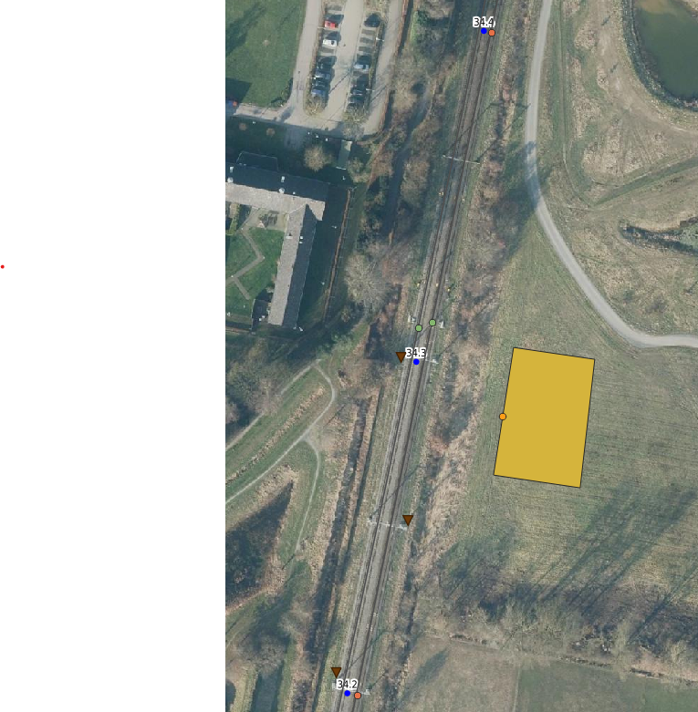

# Tutorial: eenvoudige OURS-berekening voor een spoortrillingscase bij Beilen

In deze tutorial bouwen we stap voor stap een eenvoudige `input.xml` op voor een OURS-berekening. Dit is ook de standaard-XML die wordt ingeladen bij het opstarten van `OURS.exe`. De case is gebaseerd op een spoorlocatie bij Beilen, waar naast het spoor een fictief gebouw wordt beschouwd.

Het doel van deze tutorial is om nieuwe gebruikers een basisidee te geven van:

- de opbouw van een `input.xml`
- de betekenis van de belangrijkste XML-elementen
- het interpreteren van de belangrijkste resultaten in de `output.xml`

In deze tutorial gaan we ervan uit dat we geïnteresseerd zijn in de **trillingssnelheid op funderingsniveau**, uitgedrukt als:

- `Vmax_50`
- `Vmax_p`

waarbij in deze tutorial `p = 0.95` wordt gebruikt. Dit betekent dat `Vmax_p` de waarde is die met 95% kans wordt onderschreden.

---

## 1. Beschrijving van de situatie

Deze tutorial beschrijft een vereenvoudigde case bij Beilen.

In de werkelijke situatie liggen hier twee spoorlijnen. Voor deze tutorial modelleren we alleen het **dichtstbijzijnde spoor**, zodat het voorbeeld overzichtelijk blijft. Naast dit spoor plaatsen we een fictief gebouw. Het receptorpunt ligt op de gevel van dit gebouw, op ongeveer **25 m afstand** van het spoor. Het receptorpunt is het oranje puntje in de figuur.

In de omgeving zijn ook sonderingen aanwezig. Dit zijn de bruine driehoekjes in de figuur. Deze worden door OURS gebruikt om de bodemopbouw te bepalen.

Verder nemen we aan dat:

- een **ES-las** aanwezig is (het groene puntje op het spoor)
- alleen **reizigerstreinen van het type VIRM** rijden
- op de eerste 100 m van het spoor met een andere snelheid wordt gereden dan op de 100 m daarna
- de modelinstelling `p = 0.95` wordt gebruikt voor de onzekerheid (in de config file van OURS: `P=0.95`)



*Figuur 1. Overzicht van de gemodelleerde situatie bij Beilen.*

---

## 2. Bestanden in deze tutorial

Deze map bevat de volgende bestanden:

- `tutorial_01.md` – deze toelichting
- `input_tutorial_01.xml` – de volledige invoer van het voorbeeld
- `OURS_output_tutorial_01.xml` – de output van het voorbeeld
- `OURS_output_tutorial_01.txt` – detailuitvoer van het voorbeeld
- `figures/tutorial_afbeelding.png` – afbeelding van de situatie

---

## 3. Stap 1 – Begin van de XML

Een OURS-invoerbestand begint met het root-element `<OURS_Input>`.

```xml
<OURS_Input version="V3.0">
    <Project>
    </Project>
</OURS_Input>
```

---

## 4. Stap 2 – Projectgegevens

We beginnen met een naam en beschrijving voor het project.

```xml
<OURS_Input version="V3.0">
    <Project>
        <name>Example Tutorial 1.0</name>
        <description>Voorbeeld modellering van 1 spoor</description>
    </Project>
</OURS_Input>
```

### Uitleg

- `<name>` is de projectnaam.
- `<description>` is een korte omschrijving van de case.

Deze velden komen later ook terug in de output.

---

## 5. Stap 3 – Receptor toevoegen

Nu voegen we een receptor toe. Dit is het rekenpunt waarvoor OURS de trillingsrespons bepaalt. In dit geval is de receptor op `(231518.46, 541984.25)` geplaatst.

```xml
<Receptors>
    <Receptor>
        <name>001</name>
        <description>rekenpunt 001 gevel fictief gebouw</description>
        <location>231518.46 541984.25</location>
    </Receptor>
</Receptors>
```

### Uitleg

- Alle coördinaten zijn in het RD-stelsel.
- In de invoer worden de coördinaten gescheiden door een spatie.

---

## 6. Stap 4 – Gebouwgegevens

Binnen de receptor voegen we ook gebouwgegevens toe.

```xml
<Building>
    <bagId>0000123456789012</bagId>
    <yearOfConstruction>2026</yearOfConstruction>
    <apartment>0</apartment>
    <buildingHeight>12</buildingHeight>
    <numberOfFloors>4</numberOfFloors>
    <heightOfFloor>3</heightOfFloor>
    <floorNumber>3</floorNumber>
    <wallLength>26.0</wallLength>
    <facadeLength>37.0</facadeLength>
    <varYearOfConstruction>0</varYearOfConstruction>
    <varApartment>1</varApartment>
    <varBuildingHeight>5</varBuildingHeight>
    <varNumberOfFloors>0</varNumberOfFloors>
    <varHeightOfFloor>0.3</varHeightOfFloor>
    <varFloorNumber>0</varFloorNumber>
    <varWallLength>5</varWallLength>
    <varFacadeLength>5</varFacadeLength>
</Building>
```

### Uitleg

Met dit blok beschrijven we het fictieve gebouw. De belangrijkste velden zijn:

- `bagId`: het BAG-id; hier een fictief nummer
- `yearOfConstruction`: bouwjaar; wordt gebruikt om ontbrekende parameters te schatten
- `apartment`: dit voorbeeld betreft geen appartement, dus deze waarde is `0` (`False`)
- `buildingHeight`: totale gebouwhoogte; in dit voorbeeld 12 m
- `numberOfFloors`: aantal verdiepingen; in dit voorbeeld 4
- `heightOfFloor`: hoogte per verdieping; in dit voorbeeld 3 m
- `floorNumber`: verdieping van het receptorpunt; in dit voorbeeld verdieping 3. Verdieping 0 is de begane grond, dus dit is de hoogste verdieping
- `wallLength`: lengte van de zijwand; in dit voorbeeld 26 m
- `facadeLength`: lengte van de gevel; in dit voorbeeld 37 m

OURS berekent de `p`-waarde op basis van onzekerheden. Daarbij worden ook de onzekerheden in de invoer meegenomen. Dat zijn de variabelen die beginnen met `var`.

- `varApartment`: hier kan de onzekerheid tussen `0.5` (ik weet het niet zeker) en `1` (ik weet het zeker) liggen. Hier nemen we `1`
- `varBuildingHeight`: we nemen een waarde van 5; in deze tutorial interpreteren we dat als een gebouwhoogte tussen 7 en 17 m met 95% kans
- `varNumberOfFloors`: we verwachten dat het aantal verdiepingen tussen 4 en 4 ligt met 95% kans
- `varHeightOfFloor`: we verwachten dat de hoogte van een verdieping tussen 2.7 en 3.3 m ligt met 95% kans
- `varFloorNumber`: we verwachten dat het verdiepingsnummer tussen 3 en 3 ligt met 95% kans
- `varWallLength`: we verwachten dat de lengte van de muur tussen 21 en 31 m ligt met 95% kans
- `varFacadeLength`: we verwachten dat de gevel tussen 32 en 42 m ligt met 95% kans

---

## 7. Stap 5 – Vloergegevens

Daarna volgt het vloerblok.

```xml
<Floor>
    <frequenciesQuarterSpan></frequenciesQuarterSpan>
    <frequenciesMidSpan></frequenciesMidSpan>
    <floorSpan>5</floorSpan>
    <woodenFloor>0</woodenFloor>
    <varFrequenciesQuarterSpan></varFrequenciesQuarterSpan>
    <varFrequenciesMidSpan></varFrequenciesMidSpan>
    <varFloorSpan>1</varFloorSpan>
    <varWoodenFloor>1</varWoodenFloor>
</Floor>
```

### Uitleg

In deze tutorial hebben we geen informatie over de frequenties van de vloer, dus deze velden laten we leeg.

Belangrijk is hier:

- `woodenFloor = 0` betekent dat we weten dat er geen houten vloer is
- `floorSpan = 5` betekent dat de overspanning van de vloer naar verwachting 5 meter is
- `varFloorSpan = 1` betekent dat we aannemen dat de overspanning tussen 4 en 6 meter ligt met 95% kans

Omdat in deze tutorial de focus ligt op **funderingsrespons**, zijn deze waarden minder bepalend dan bijvoorbeeld de spoor- en brongegevens.

---

## 8. Stap 6 – Het spoor definiëren

Nu voegen we het gewone spoor toe als bron. In dit geval voegen we 200 meter spoor toe. OURS bepaalt per receptor het dichtstbijzijnde punt op het spoor als bronlocatie. Een korter stuk spoor had in dit geval dus ook gekund. Het begin- en eindpunt van het spoor is in figuur 1 te zien als de twee oranje punten op het spoor.

```xml
<Tracks>
    <Track>
        <name>001</name>
        <description>track 001</description>
        <branch_id>00001</branch_id>
        <kmstart>34200000</kmstart>
        <kmend>34400000</kmend>
        <sourcetype>track</sourcetype>
        <location>231475.517 541901.515 231515.209 542098.222</location>
    </Track>
</Tracks>
```

### Uitleg

De belangrijkste velden zijn:

- `name`: naam van de bron
- `description`: omschrijving van de bron
- `branch_id`: identificatie van de spoorlijn
- `kmstart` en `kmend`: kilometering van het gemodelleerde traject
- `sourcetype`: type bron; hier doorgaand spoor
- `location`: de RD-coördinaten van de spoorlijn

In dit geval is een spoorlijn gemodelleerd tussen de punten `(231475.517, 541901.515)` en `(231515.209, 542098.222)`.

---

## 9. Stap 7 – Het spoor opdelen in twee trackparts en treinen toevoegen

Het spoor wordt opgesplitst in twee delen, zodat per deel andere snelheden kunnen worden opgegeven. Ook voegen we het treinverkeer toe.

### Eerste trackpart

```xml
<Trackpart>
    <name>1_001</name>
    <description>trackpart 1_001</description>
    <kmstart>34200000</kmstart>
    <kmend>34300000</kmend>
    <superstructure_id>1</superstructure_id>
    <substructure_id>1</substructure_id>
    <cGeoX>1.0 1.0 1.0 1.0 1.0 1.0</cGeoX>
    <cGeoZ>1.0 1.4 0.7 0.8 1.3 1.0</cGeoZ>
    <Train>
        <material_id>1</material_id>
        <qd>5</qd>
        <vd>130</vd>
        <qe>4</qe>
        <ve>120</ve>
        <qn>0.5</qn>
        <vn>120</vn>
    </Train>
</Trackpart>
```

### Tweede trackpart

```xml
<Trackpart>
    <name>1_002</name>
    <description>trackpart 1_002</description>
    <kmstart>34300000</kmstart>
    <kmend>34400000</kmend>
    <superstructure_id>1</superstructure_id>
    <substructure_id>1</substructure_id>
    <cGeoX>1.0 1.0 1.0 1.0 1.0 1.0</cGeoX>
    <cGeoZ>1.0 1.4 0.7 0.8 1.3 1.0</cGeoZ>
    <Train>
        <material_id>1</material_id>
        <qd>5</qd>
        <vd>80</vd>
        <qe>4</qe>
        <ve>80</ve>
        <qn>0.5</qn>
        <vn>80</vn>
    </Train>
</Trackpart>
```

### Uitleg

Elke `Trackpart` beschrijft een deel van het spoor met eigen eigenschappen.

Belangrijke velden:

- `cGeoX` en `cGeoZ`: correctiefactoren van de spoorligging. Een waarde van 1 betekent een spoorligging die gelijk is aan het Nederlandse gemiddelde. Deze factoren worden gebruikt om de bronkracht mee te schalen. Er wordt een factor opgegeven voor alle octaafbanden `(2, 4, 8, 16, 32, 64) Hz`. Als er geen informatie beschikbaar is, wordt aangeraden overal `1` in te vullen. In dit geval gaan we ervan uit dat we informatie hebben over de verticale spoorligging.
- `Train`: verkeersgegevens voor dit spoorsegment

Binnen `Train` betekenen de velden:

- `material_id`: type treinmaterieel; voor de VIRM wordt categorie 1 gekozen. Zie bijlage 1 van de OURS-handleiding voor alle treincategorieën.
- `qd`, `qe`, `qn`: aantallen treinen per uur in respectievelijk de dag-, avond- en nachtperiode
- `vd`, `ve`, `vn`: snelheden in de dag-, avond- en nachtperiode

---

## 10. Stap 8 – De ES-las modelleren als aparte bron

Naast het gewone spoor modelleren we ook een ES-las. Dit is een lokale spooronregelmatigheid die extra trillingen kan veroorzaken.

In de XML modelleren we deze als een aparte bron met `sourcetype = weld`.

```xml
<Track>
    <name>001</name>
    <description>track 001</description>
    <branch_id>00001</branch_id>
    <kmstart>34200000</kmstart>
    <kmend>34400000</kmend>
    <sourcetype>weld</sourcetype>
    <location>231497.679 542012.294 231497.611 542011.837</location>
    <Trackpart>
        <name>2_001</name>
        <description>trackpart 1_001</description>
        <kmstart>34200000</kmstart>
        <kmend>34400000</kmend>
        <superstructure_id>1</superstructure_id>
        <substructure_id>1</substructure_id>
        <cGeoX>1.0 1.0 1.0 1.0 1.0 1.0</cGeoX>
        <cGeoZ>1.0 1.4 0.7 0.8 1.3 1.0</cGeoZ>
        <Train>
            <material_id>1</material_id>
            <qd>5</qd>
            <vd>130</vd>
            <qe>4</qe>
            <ve>120</ve>
            <qn>0.5</qn>
            <vn>120</vn>
        </Train>
    </Trackpart>
</Track>
```

### Uitleg

- `sourcetype = weld` geeft aan dat deze bron een las of lokale spooronregelmatigheid representeert.

---

## 11. Complete input_tutorial_01.xml

De volledige invoer van dit voorbeeld staat in:

[`input_tutorial_01.xml`](./input_tutorial_01.xml)

De structuur van het volledige bestand is als volgt:

```xml
<OURS_Input version="V3.0">
    <Project>
        <name>Example Tutorial 1.0</name>
        <description>Voorbeeld modellering van 1 spoor</description>
        <Receptors>
            ...
        </Receptors>
        <Tracks>
            ...
        </Tracks>
    </Project>
</OURS_Input>
```

Voor de volledige details wordt verwezen naar het bestand zelf.

---

## 12. Uitvoer van de berekening

Na het uitvoeren van de berekening wordt een [`OURS_output_tutorial_01.xml`](./OURS_output_tutorial_01.xml) gegenereerd. In deze tutorial is een voorbeeldoutput opgenomen in:


In de output worden per receptor de resultaten gegeven voor elke bron.

In dit voorbeeld zijn er twee bronnen:

1. het reguliere spoor (`sourcetype = track`)
2. de ES-las (`sourcetype = weld`)

Per bron wordt onder andere gerapporteerd:

- afstand van receptor tot bron
- resultaten in `X-Richting`
- resultaten in `Z-Richting`
- resultaten voor:
  - `Fundering`
  - `Gebouw`
  - `Maaiveld`

Met `OURS.exe` wordt ook een [`OURS_output_tutorial_01.txt`](./OURS_output_tutorial_01.txt) -bestand gegenereerd. Dit bevat detailinformatie van de berekening en geeft veel aanvullende informatie over de berekening.

---

## 13. De output lezen

Voor deze tutorial ligt de nadruk op de resultaten aan de `Fundering`. Er kan natuurlijk ook naar andere uitvoer worden gekeken.

Een voorbeeld van een funderingsblok in de output is:

```xml
<Fundering>
    <Vmax_50>0.15</Vmax_50>
    <Vmax_p>0.78</Vmax_p>
    <Vmax_Fdom>63 Hz</Vmax_Fdom>
    <Maatgevende_cat>1</Maatgevende_cat>
    <Vtop_50>0.37</Vtop_50>
    <Vtop_p>1.86</Vtop_p>
    <Vtop_Fdom>63 Hz</Vtop_Fdom>
    <Vtop_Vd>2.98</Vtop_Vd>
</Fundering>
```

### Betekenis van de belangrijkste velden (voor deze analyse)

- `Vmax_50`: representatieve of mediane maximale trillingssnelheid
- `Vmax_p`: maximale trillingssnelheid bij de gekozen kansparameter `p`
- `Vmax_Fdom`: dominante frequentie van `Vmax`

---

## 14. Maatgevende funderingsrespons

We willen de maatgevende trillingssnelheid op funderingsniveau bepalen.

Daarvoor nemen we de hoogste waarde van:

- alle gemodelleerde bronnen
- beide richtingen (`X-Richting` en `Z-Richting`)

### Resultaten per bron en richting

| Bron  | Richting | `Vmax_50` fundering | `Vmax_p` fundering |
|-------|----------|--------------------:|-------------------:|
| Track | X        | 0.15                | 0.78               |
| Track | Z        | 0.10                | 0.46               |
| Weld  | X        | 0.18                | 0.92               |
| Weld  | Z        | 0.12                | 0.57               |

### Maatgevend resultaat

In deze voorbeeldcase is de hoogste funderingswaarde:

- `Vmax_50 = 0.18`
- `Vmax_p = 0.92`

Deze maatgevende waarde komt uit:

- bron: **weld**
- richting: **X-Richting**

Diepere analyse van deze resultaten kan worden verkregen door middel van de overige uitvoer en de detailuitvoer. Dat valt buiten de scope van deze tutorial.

### Betekenis van `p = 0.95`

In de output staat:

```xml
<Settings>
    <Vd>False</Vd>
    <p>0.95</p>
</Settings>
```

Dat betekent dat `Vmax_p` is bepaald voor een kansniveau van **95%**.

---

## 15. Samenvatting

In deze tutorial is stap voor stap een eenvoudige OURS-invoer opgebouwd voor een spoortrillingscase bij Beilen.

De case bevat:

- één receptor
- één fictief gebouw
- één gemodelleerd spoor
- twee trackparts met verschillende snelheden
- één ES-las als aparte bron met `sourcetype = weld`

Met deze opzet kan een gebruiker zien:

- hoe een `input.xml` is opgebouwd
- welke invoer nodig is voor receptor, gebouw en spoor
- hoe een lokale spooronregelmatigheid apart gemodelleerd kan worden
- hoe de output wordt gelezen

Voor deze case is de maatgevende funderingsrespons:

- `Vmax_50 = 0.18`
- `Vmax_p = 0.92`

---